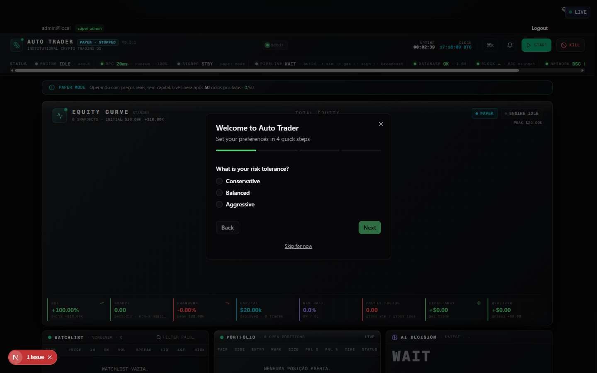
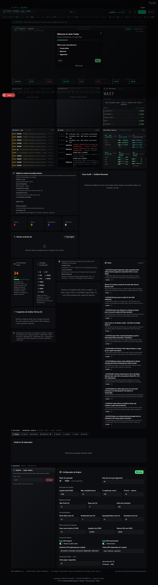
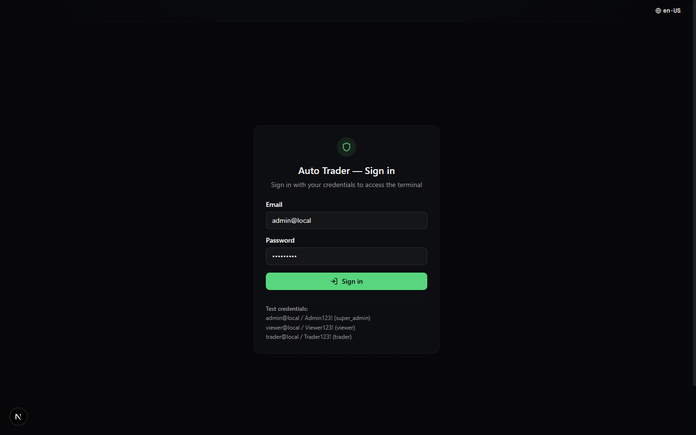
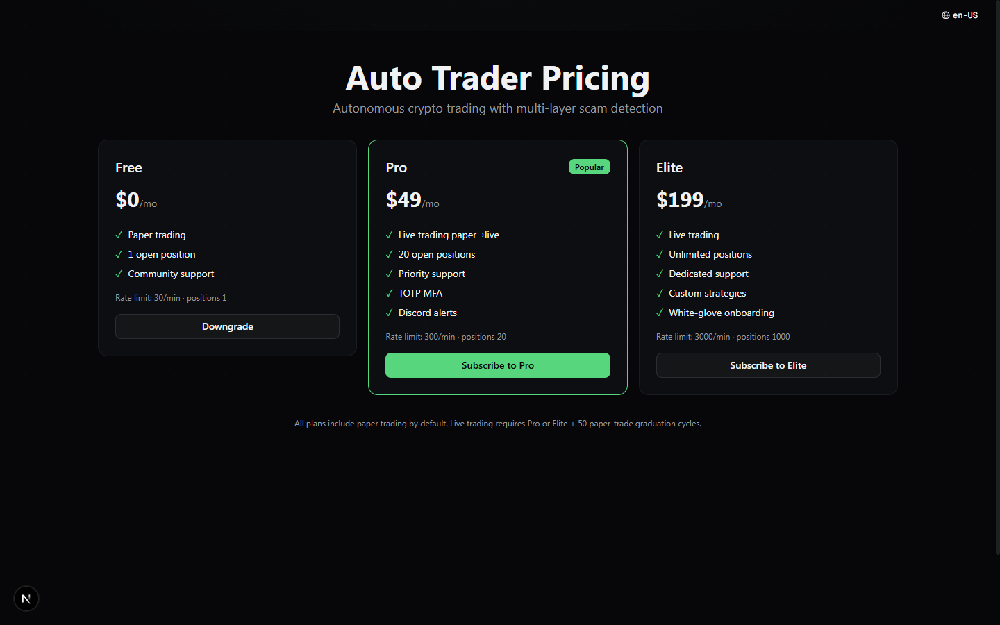
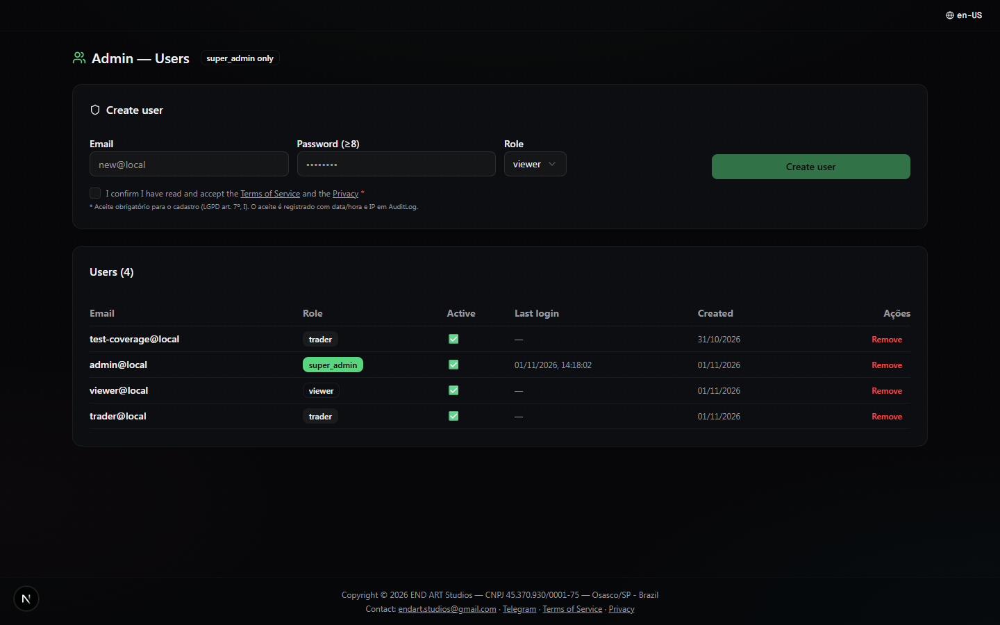

# 01 · Auditoria da interface atual

**Escopo:** aplicação em `D:\PROJETOS\Auto Trader\Auto Trader` (Next.js 16, App Router), branch `main` em 01/11/2026.
**Método:** navegação real com `ego-browser` (Chromium 156) em 1440×900 e 390×844, leitura de código e inspeção de DOM/CSS. Todas as capturas em [`img/before/`](img/before/).

---

## Resumo executivo

A aplicação funciona, mas a interface foi construída como um **painel único e denso**, não como um produto. Ela responde a “o bot está rodando?” e falha nas perguntas que um operador realmente faz: *onde estou perdendo dinheiro, por quê, e o que devo fazer agora?*

Sete problemas explicam quase todo o atrito percebido:

| # | Problema | Impacto |
|---|---|---|
| 1 | Uma página de **5.284 px** com 12 domínios sem URL própria | Sem deep link, sem voltar, sem compartilhar; recarregar perde o contexto |
| 2 | Hierarquia tipográfica inexistente (tudo 8–11 px, caixa alta, mesmo peso) | O olho não sabe onde começar; leitura exige esforço |
| 3 | Cor sem semântica (verde neon = marca = lucro = status) | Falso positivo de “tudo certo”; daltonismo agrava |
| 4 | Navegação escondida (paleta ⌘K + abas a 4.700 px de distância) | Usuário não descobre 8 dos 12 módulos |
| 5 | Estados vazios como buracos negros (`WATCHLIST VAZIA.`) | Nenhum caminho de próximo passo |
| 6 | i18n incompleto (PT dentro de UI em inglês) | Quebra de confiança e de profissionalismo |
| 7 | Sem responsividade real (grid de 3 colunas em 390 px) | Inutilizável no celular, que é onde o operador checa posições |

---

## 1. Arquitetura de informação

**Evidência:** a página inicial (`/`) tem **5.284 px de altura** em 1440×900 — cerca de 5,9 telas de rolagem. Contém, na ordem: cabeçalho de status, banner paper, equity curve, faixa de 8 métricas, watchlist, posições, decisão de IA, order flow, logs, system health, vigilância de posições, site audit, fear & greed, trending, notícias (20+ itens), snapshots técnicos, explorador com 8 abas, histórico, reserva e configuração da engine.

**Consequências**

- Nenhum painel tem rota. `/` é o único endereço do produto: não há link para “posições”, “risco” ou “um trade específico”.
- O botão voltar do navegador não devolve o usuário ao contexto anterior.
- Recarregar reposiciona no topo; o estado das abas vive só em memória (`activeTab`).
- O único atalho de navegação é a paleta `⌘K`, que **não tem affordance** além de um botão pequeno no canto.
- A seção “EXPLORER” fica a ~4.700 px do topo e replica, com outra linguagem visual, informação que já aparece acima.

## 2. Hierarquia e tipografia

**Medições no DOM:** títulos de cartão em 10–11 px, rótulos em 8–9 px com `letter-spacing` alto, corpo em 12–13 px, `line-height` ~1.2. Não existe um `<h1>` visível: o nome do produto (“AUTO TRADER”) ocupa o lugar do título e o conteúdo começa sem hierarquia.

- Tudo é caixa alta e do mesmo peso — 34 rótulos competem pela mesma atenção.
- Números não são tabulares em todas as tabelas; colunas de preço desalinham.
- Métricas usam 3 formatos diferentes (`$20.00K`, `$20,000.00`, `+100.00 %`).
- Unidades e períodos aparecem soltos (`20ms`, `1.5M`, `quorum · 100%`) sem agrupamento semântico.

## 3. Cor e contraste

- Fundo `#000` puro + verde neon como única cor de destaque.
- Verde significa simultaneamente **marca**, **lucro** e **status positivo** — três significados no mesmo token.
- Texto secundário `muted-foreground` sobre `#000` em 10 px fica abaixo de 4.5:1 (WCAG AA) em vários pontos.
- Status é comunicado só por cor e por emoji (`✅` na tabela de usuários), sem rótulo textual consistente.
- Não há tema claro; em ambientes iluminados a leitura piora.

## 4. Navegação e ações

- Sistema de status no topo transborda: em 1440 px aparece **barra de rolagem horizontal** na faixa de telemetria (visível na captura, abaixo do cabeçalho).
- `START` e `KILL` ficam lado a lado, com o mesmo tamanho e a mesma proeminência — o botão mais destrutivo do produto é um vizinho de clique do mais comum.
- O “kill switch” não pede confirmação tipada; um clique errado interrompe a operação.
- A paleta de comandos existe, mas não há dica visual dela (apenas `⌘K` em botão de 28 px).
- Ações de linha em tabelas não aparecem até o hover — invisíveis em telas de toque.

## 5. Estados vazios e onboarding

- Equity curve vazio ocupa ~360 px de preto com o texto “AGUARDANDO ROUNDS PARA CONSTRUIR EQUITY CURVE” em 10 px.
- Watchlist vazia: uma única linha de tabela com “WATCHLIST VAZIA.”
- Onboarding é um modal de 4 etapas **sobre** o dashboard denso: o usuário decide risco sem ver consequência.
- “Skip for now” tem o mesmo peso visual do “Next”.
- Credenciais de teste (`admin@local / Admin123!`) aparecem na tela de login — aceitável só em desenvolvimento, mas está no componente de produção.

## 6. i18n e conteúdo

- Mistura de idiomas na mesma tela: “Paper mode — real prices…” com “Operando com preços reais, sem capital”, “Nenhuma posição aberta.”, “Nenhuma operação fechada ainda.”.
- Jargão sem explicação: “institutional crypto trading OS”, “scout”, “graduation”, “quorum”, “EV_REAL”.
- Datas em formatos diferentes (`31/10/2026`, `01/11/2026, 14:18:02`, `14:22`).
- Números sem contexto de período em várias métricas (ROI “ALL-TIME” ao lado de “30d”).

## 7. Responsividade e acessibilidade

- Em 390 px o layout mantém 2–3 colunas; tabelas de 9 colunas geram overflow horizontal de 406–503 px.
- Não há `aria-live` para preços/alertas; leitores de tela não recebem atualização.
- Vários alvos de clique são `div`/`span` sem `role` e sem foco visível.
- Não há link “pular para conteúdo”, nem marcos (`landmark`) de navegação.
- Contraste de `outline` de foco no tema escuro é baixo.

## 8. Consistência de componentes

- Botões com 5 alturas diferentes (`h-7`, `h-8`, `h-9`, `px-2.5`, `px-3`) e 3 raios.
- Cartões com 4 padrões distintos de cabeçalho.
- Tabelas com alturas de linha de 22 px a 44 px na mesma tela.
- Badges “PAPER” repetidos em 4 lugares, com estilos diferentes.

## 9. Páginas públicas

- `/pricing`: 3 cartões genéricos, sem alternância mensal/anual, sem tabela comparativa, sem FAQ, sem prova social. O plano gratuito tem botão **“Downgrade”** — ação que não deveria existir para quem já está nele.
- `/login`: cartão centralizado, sem marca, sem “esqueci a senha”, sem MFA, com título duplicado (“Auto Trader — Sign in”).
- `/admin/users`: tabela funcional, porém com emoji como status, mistura PT/EN e sem busca, paginação ou ações em lote.
- `/terms` e `/privacy`: texto puro, sem índice, sem tipografia de leitura.
- **Não existe landing page**: `/` redireciona para o login, então o produto não se explica antes de pedir credenciais.

---

## O que preservar

Nem tudo deve ser descartado. A auditoria também identificou ativos valiosos:

1. **Profundidade funcional real** — scanner, gates de segurança, paper→live, backtest, auditoria encadeada, copiloto. É mais do que a maioria dos concorrentes oferece.
2. **Estética de instrumento** — a ideia de “terminal” é adequada ao domínio; o problema é a execução (escala, cor, hierarquia), não o conceito.
3. **Vocabulário de risco** — “paper mode”, “gates”, “graduation” são bons nomes; precisam de definição visível.
4. **Componentes já acessíveis** — a base Radix/shadcn (dialog, dropdown, tabs, table) é sólida e deve ser reaproveitada.
5. **Dark-first** — correto para sessões longas; só precisa de tema claro e de contraste adequado.

---

## Métricas de sucesso propostas

| Métrica | Hoje | Meta do redesign |
|---|---|---|
| Telas até “posso parar o bot?” | 1 (rolagem até o topo) | 0 (sempre visível no topbar) |
| Profundidade da home | 5.284 px | ≤ 1.200 px |
| Tempo para achar uma posição | ~25 s (rolagem + leitura) | ≤ 5 s (rail ou ⌘K) |
| Cobertura de deep link | 0 rotas de detalhe | 100% das entidades |
| Contraste mínimo de texto | < 4.5:1 em 9 pontos | ≥ 4.5:1 em todo texto |
| Overflow horizontal em 390 px | sim (406–503 px) | 0 |
| Idiomas misturados na UI | sim | não (chave i18n única) |
| Estados vazios com ação | 0 de 6 | 6 de 6 |
